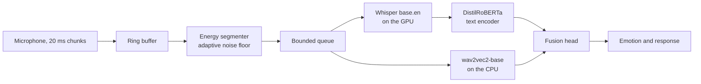

# EmoPerf

EmoPerf listens to speech, transcribes it, and tags each sentence with one of seven emotions, about a third of a second after the speaker stops. I built it as a performance engineering project: the models are small and frozen, and most of the work went into measuring where the time goes on a MacBook Air M5, finding the bottlenecks with profilers, and cutting latency without losing accuracy.

| Live pipeline, 100 sentences streamed in real time | Before | After |
|---|---|---|
| Time from end of speech to answer, p50 | 525 ms | 327 to 329 ms |
| Same, p95 | 641 ms | 366 to 372 ms |
| Model time per sentence, p50 | 224 ms | 127 ms |
| Real-time factor (compute time / audio time) | 0.072 | 0.041 |
| Weighted F1 on those sentences | 0.503 | 0.503 |

"After" is two repeated runs, which is why it is a range. Accuracy stayed the same because the speedup comes from where the models run, and the only setting that changed what the pipeline hears is the silence timeout, which split one more sentence out of 100. The raw results are in `bench/results/`, and every experiment, including the ones that failed, is written up in [docs/experiments.md](docs/experiments.md).

## Try the demo

```bash
.venv/bin/python demo.py --web
```

This opens http://127.0.0.1:8765. Stay quiet for one second while it measures the room noise, then talk. Each sentence's emotion appears in large type, and a strip at the bottom of the screen shows your voice with every sentence colored by its emotion and the gap between when you stopped and when the answer arrived. Run it from the macOS Terminal app; other hosts may not have microphone permission, in which case macOS sends silence and the page says so. Everything runs locally. [docs/DEMO.md](docs/DEMO.md) lists the flags and troubleshooting steps.

## How it works



Audio arrives in 20 ms chunks and goes into a fixed-size ring buffer. The producer never blocks, so if the consumer falls behind, the oldest audio is overwritten and counted. A segmenter decides where each sentence ends by waiting for 0.2 s of quiet relative to the room's noise level. Each sentence then goes down two branches at once: Whisper transcribes it and DistilRoBERTa encodes the words, while wav2vec2 encodes the tone of voice. A small fusion head, trained on cached outputs of the text and audio encoders, picks the emotion, and a template writes the reply.

The encoders are pretrained and frozen. None of them was trained on emotion data, so the test set cannot leak through them.

## What profiling found

I profiled with `torch.profiler` (traces opened in Perfetto) and with Instruments' Time Profiler, and wrote a hypothesis down before each one. Details are in entry E4 of the experiments log.

The largest cost was Whisper's encoder, at 41% of the profiled time. Whisper pads every clip to 30 seconds, so the median 2.5 s sentence was 92% padding. The encoder took about 93 ms on every clip regardless of length (correlation with clip length r = 0.06), while the wav2vec2 branch, which sees only the real audio, tracked length almost exactly (r = 0.99).

Whisper's decoding loop came second at about 7 ms per token. I expected Python overhead between operations to dominate, and it didn't: only 10.7% of the loop's time fell between operations. Two things stood out instead. The output projection over the 51,864-token vocabulary ran on every token, and two Hugging Face logits processors rebuilt the same full-vocabulary mask on every step with `torch.isin`, which sorts the vocabulary each time. That rebuild took 16.6% of the loop's operator time.

Running the two branches at the same time mostly didn't help, because they fought over the CPU. Each branch started its own 4-thread OpenMP team, so up to 8 compute threads competed for 4 performance cores. In the Instruments traces, the share of work on the slower efficiency cores doubled (13.5% to 28.2%), and the same sentences took 24% more CPU time.

## What helped and what didn't

Each row changes one thing from the baseline (sequential, 4 threads, CPU, fp32) and was measured on 100 test clips, two rounds in opposite orders. The baseline drifted between 192 and 203 ms across sessions, so I compare small effects only against the baseline from the same session.

| Change | Model time p50 vs baseline | Accuracy effect | Kept |
|---|---|---|---|
| 1 thread instead of 4 | 0.71x | none | no |
| 6, 8 or 10 threads | 1.00x to 1.02x | none | no |
| Run both branches at once on the CPU | 1.09x | none | yes, then replaced |
| Same, with threads split 2 + 2 or 1 + 3 | 0.99x to 1.02x | none | no |
| Build the vocabulary mask once (patched processors) | 1.01x (Whisper 3.6% faster) | identical tokens | yes |
| Trim Whisper's input to the real audio plus a margin | 1.32x to 1.61x | word error rate up to 2.39; the mildest setting still lost 0.037 weighted F1 | no |
| Dynamic int8 quantization (qnnpack) | 0.48x | word error rate 0.32 to 0.38 | no |
| bf16 or fp16 on the CPU | 0.06x to 0.07x | none | no |
| `torch.compile` on the three encoders | 0.97x | none | no |
| ONNX Runtime, CPU provider (encoders only) | 0.72x to 0.82x | none | no |
| ONNX Runtime, Core ML provider (encoders only) | 0.32x to 0.47x | outputs off by 5 to 16% | no |
| All three models on the GPU (MPS) | 1.98x | identical | yes, then replaced |
| Whisper on the GPU and wav2vec2 on the CPU, in parallel, plus the mask fix | 2.42x (p95 2.71x) | identical | yes |

A few of these are worth explaining. Trimming Whisper's padding attacked the biggest hotspot and made it fast, but Whisper hallucinated on short windows: outputs ran much longer than the reference, and p95 latency got worse because those runaway outputs take many decoding steps. Lower precision was a large slowdown. In this PyTorch build, fp32 matrix multiplies run in Apple's Accelerate library, and the lower-precision paths are much slower: a Whisper-sized feed-forward layer took 5.1 ms in fp32, 17.8 ms in int8, 28.3 ms in fp16 and 45.6 ms in bf16. `torch.compile` probably had little to fuse, since the encoders spend most of their time in those same Accelerate calls and the decoding loop stayed uncompiled. Running the branches in parallel only paid off once they used different hardware, so neither slowed the other down.

The live result in the first table combines the last row with a shorter silence timeout (0.3 s to 0.2 s), which saves 100 ms and splits one more sentence out of 100. A sweep of that setting is in entry E6.

## Accuracy

MELD has seven emotion classes and is heavily imbalanced: 48% of test sentences are neutral. Always answering "neutral" gets 48% accuracy, so I report weighted and macro F1 instead. Results on the full test set (2,610 sentences, human transcripts, mean and standard deviation over 3 seeds):

| Model | Weighted F1 | Macro F1 |
|---|---|---|
| Always "neutral" | 0.313 | 0.093 |
| Audio only | 0.464 ± 0.004 | 0.276 ± 0.004 |
| Text only | 0.605 ± 0.002 | 0.423 ± 0.009 |
| Text and audio | 0.613 ± 0.008 | 0.428 ± 0.013 |

For context, the original MELD paper reports 59.25 to 60.25 weighted F1 for its text and audio baselines, and a fine-tuned RoBERTa-large reaches 63.46 without conversation context and 65.61 with it. The gap between audio-only and text-and-audio here is about the size of the variation between seeds, so I don't claim that adding audio helps on clean transcripts. [docs/related_results.md](docs/related_results.md) has the exact tables and sources.

The live pipeline scores lower, because it reads Whisper's transcripts instead of human ones. On 500 test sentences, swapping in Whisper's text costs 0.086 weighted F1 and the segmenter costs another 0.010. Training the fusion head on a mix of human and Whisper transcripts recovers 0.013 on the full test set (95% bootstrap interval 0.004 to 0.022); the demo uses that head. Most of the gap is words Whisper gets wrong on TV audio, with laugh tracks and crosstalk, so the next gains would come from a better speech recognizer or from conversation context.

## Reproducing the results

Everything was measured on a MacBook Air (Mac17,3) with an Apple M5 (4 performance and 6 efficiency cores, 8-core GPU) and 16 GB of memory, running macOS 26.6.2 on AC power, with PyTorch 2.15.0, transformers 5.23.0, Python 3.12.16 and Xcode 27.2. [docs/methodology.md](docs/methodology.md) covers how runs are timed: warm-up, interleaved variants, cooldowns, thermal checks, p50 and p95.

Set up the environment:

```bash
brew install cmake ffmpeg uv
uv venv --python 3.12 .venv
uv pip install --python .venv/bin/python -r requirements.txt
```

Download MELD (10.9 GB) and check it:

```bash
mkdir -p data/raw/extracted data/labels
curl -L -C - -o data/raw/MELD.Raw.tar.gz https://huggingface.co/datasets/declare-lab/MELD/resolve/main/MELD.Raw.tar.gz
shasum -a 256 data/raw/MELD.Raw.tar.gz   # a56b4407d574195cbce470d86f9c9d72fcfea59b0e34502ecd4babee4a5c613e
tar -xzf data/raw/MELD.Raw.tar.gz -C data/raw/extracted
for s in train dev test; do tar -xzf data/raw/extracted/MELD.Raw/$s.tar.gz -C data/raw/extracted; done
for s in train dev test; do curl -sSL -o data/labels/${s}_sent_emo.csv https://raw.githubusercontent.com/declare-lab/MELD/e8cedf27b5d2877e198332c957127e16eb214afe/data/MELD/${s}_sent_emo.csv; done
```

The labels come from the MELD GitHub repository because the copies inside the archive have broken apostrophes. 132 test clips appear twice in the archive under different names; `pipeline/data/extract_audio.py` picks the copy whose length matches the label timestamps. Entry E1 lists every data problem found.

Then run each stage:

```bash
scripts/m1_rebuild.sh                  # audio, labels, cached embeddings, fusion heads, evaluation
.venv/bin/python pipeline/embed/cache_asr.py
.venv/bin/python pipeline/fusion/train.py --modes text+audio text --train-text both --dev-text asr --tag _trainboth --out bench/results/acc_train_both.json
bench/m2_runs.sh                       # live benchmark, sequential vs concurrent (about 30 min)
.venv/bin/python bench/profile_stages.py --n 30
.venv/bin/python bench/m4_suite.py     # one-change variants (about an hour)
bench/m4_live_runs.sh                  # best configuration, real time
.venv/bin/python -m pytest
```

## Limitations

- English only, and tuned on TV dialogue. Accuracy on other speech hasn't been measured.
- The latency numbers are for this laptop. The fanless chassis can throttle under long runs; none of the measured runs logged a thermal warning.
- Short replies like "yeah" or "ok" usually come out neutral, and sarcasm is usually read literally.
- In the live stream, Whisper on the GPU takes 105 to 114 ms per sentence, against 72 ms when clips run back to back. I haven't measured why; one guess is that the GPU clocks down during the pauses between sentences.

## Repository layout

```text
demo.py                  live demo (terminal or --web)
pipeline/data/           audio extraction and label index
pipeline/embed/          cached encoder outputs (human and Whisper transcripts)
pipeline/fusion/         fusion head, training, evaluation
pipeline/live/           ring buffer, queue, segmenter, model stages, session, web page
bench/                   benchmarks, profiling scripts, results
docs/                    experiments log, methodology, published results, demo guide
tests/                   unit tests for the buffer, queue, segmenter and microphone check
```

## Data, models and licenses

MELD (Poria et al., ACL 2019; built on EmotionLines, Chen et al., 2018) is distributed under GPL-3.0. Its clips come from the TV series *Friends*, so this repository contains no clips, audio, transcripts or embeddings. It has code, sentence IDs and summary numbers only. The encoders are `distilbert/distilroberta-base`, `facebook/wav2vec2-base` and `openai/whisper-base.en`, all Apache-2.0. The demo page bundles the Fraunces and IBM Plex Sans fonts under the SIL Open Font License; the license files are in `pipeline/live/web/fonts/`.

## How this was built

I used Claude Code, Anthropic's AI coding assistant, for most of the implementation. It wrote most of the code, ran the benchmarks and profiling sessions, and drafted the documentation, including this README.

I wrote the project plan it worked from. The plan set the goals and the rules: report p50 and p95, check accuracy next to every speed number, keep failed experiments in the log, and put no number in the write-up that didn't come from a real run. I made the calls along the way, like moving the project from my Windows desktop to my MacBook, choosing which accuracy experiments to run, and adding the live demo and its web page. I tested the demo with my own voice and reported what broke, including a microphone that macOS was silently blocking. When I asked how to improve accuracy, the answer started with measuring where live accuracy is lost, and my question about whether 53% was any good is why the README compares against published MELD results.
